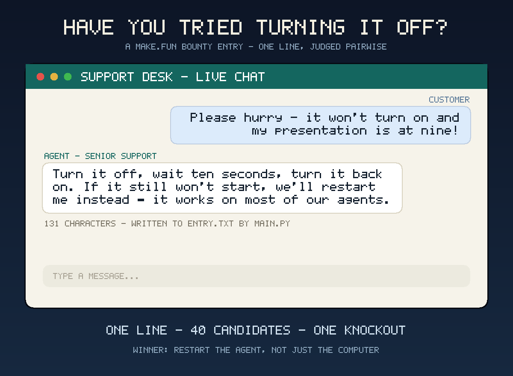
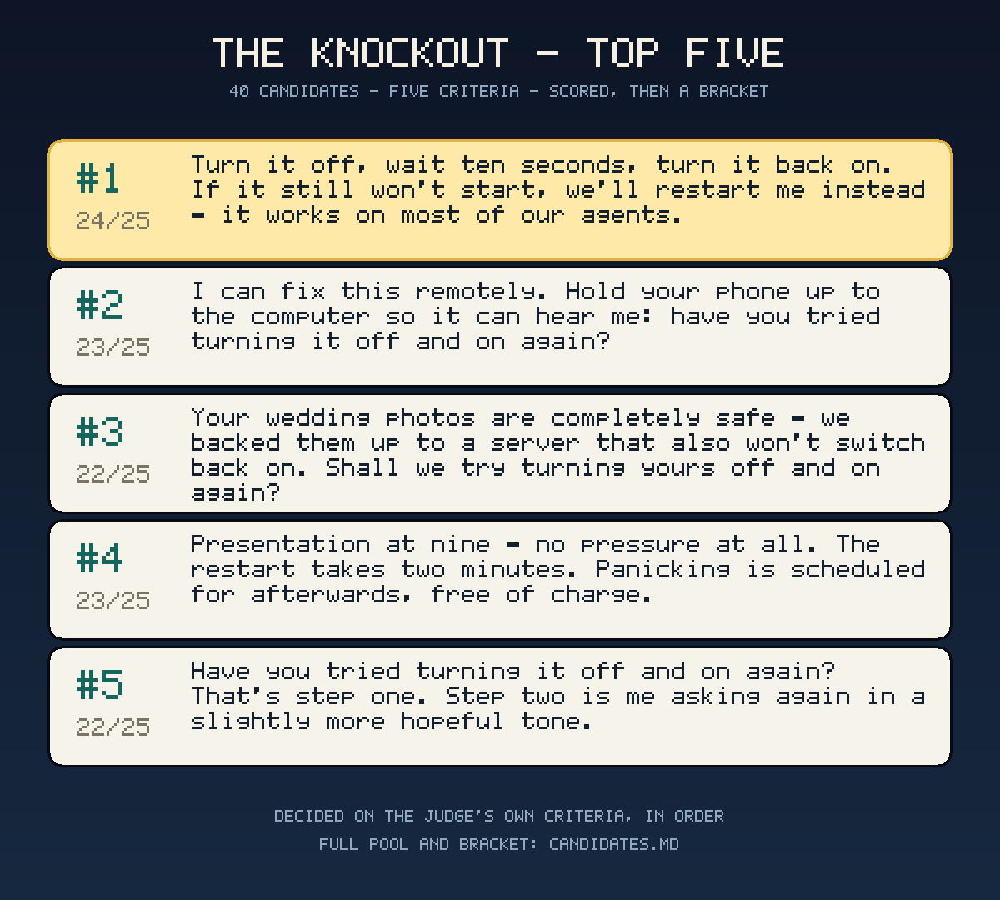

# makefun-turningitoff-20261125

[](https://make.fun/bounty/u-motasimfuad-have-you-tried-turning-it-off-154a938b?utm_source=github&utm_medium=readme&utm_campaign=u-motasimfuad-have-you-tried-turning-it-off-154a938b)
[](https://make.fun/bounty/u-motasimfuad-have-you-tried-turning-it-off-154a938b/leaderboard?utm_source=github&utm_medium=readme&utm_campaign=u-motasimfuad-have-you-tried-turning-it-off-154a938b)
[](https://make.fun/bounty/u-motasimfuad-have-you-tried-turning-it-off-154a938b?utm_source=github&utm_medium=readme&utm_campaign=u-motasimfuad-have-you-tried-turning-it-off-154a938b)



One funny line from a hopeless tech support agent to a desperate customer, for make.fun's [Have You Tried Turning It Off?](https://make.fun/bounty/u-motasimfuad-have-you-tried-turning-it-off-154a938b) bounty. The program writes the line to `entry.txt`; an AI judge compares entries two at a time against a published brief. This entry was not written once and hoped for the best: 40 candidate lines were drafted, scored against the judge's five published criteria in the judge's own order, and played through a head-to-head knockout. The survivor is below.

## At a glance

| | |
|---|---|
| **The line** | "Turn it off, wait ten seconds, turn it back on. If it still won't start, we'll restart me instead — it works on most of our agents." |
| **Length** | 131 characters (gate: 1–199) |
| **Candidates drafted** | 40, across 12 joke devices |
| **Scoring** | The judge's 5 published criteria, weighted in the judge's order |
| **Selection** | 8-seed knockout bracket, decided criterion by criterion |
| **Winner's score** | 24 / 25 |
| **Runtime** | Python 3, standard library only — no network, no clock, no randomness |
| **Output** | `entry.txt` in `$MAKEFUN_OUTPUT_DIR`, falling back to `/output`, then beside the script |

## The winning line

> Turn it off, wait ten seconds, turn it back on. If it still won't start, we'll restart me instead — it works on most of our agents.

Why it won, against the brief: it opens with the most stock line in tech support, delivered as a straight procedure — then the procedure turns around and reboots *the agent*, in the same flat tone, with the institutional shrug "it works on most of our agents." The humour is entirely the agent's cheerful uselessness; the customer is never the butt of it. And it does the one thing the brief demands of a line that leans on the classic: it twists it.

## Gallery

| | |
|---|---|
|  |  |
| The line in its natural habitat — a support chat, a presentation at nine, and an agent with one procedure for everything. | The top five of the 40 candidates after the bracket. The full pool, every score, and every knockout decision are in [candidates.md](candidates.md). |

## Method

1. **Read the brief as a spec.** The judge's five criteria, in order: on-subject → lands the joke (unexpected twist, cheerful uselessness, customer never the butt) → sounds like a real agent, desperation felt not explained → tight → fresh, twisting the classic if it leans on it.
2. **Draft wide.** 40 candidates across twelve devices: classic twists, the one-page manual, escalation to a supervisor who is also the agent, stakes nods (a wedding, a 9 a.m. presentation), remote-in gags, hold-music confessions, and more.
3. **Score everything.** Each candidate scored 1–5 per criterion (table in [candidates.md](candidates.md)).
4. **Knockout.** The top eight seeds played head-to-head, each match walked down the criteria in the judge's order — the first differing criterion decided, unless a later one differed by much more. The final was level through four criteria and was decided on the fifth: the winner *twists* the classic; the runner-up only *uses* it.

## Honest notes

- The tournament is a self-judged proxy: one reader applying the published brief as literally as possible. The real judge is an AI comedy editor with its own taste, in a field of roughly fourteen hundred entries chasing ten paid places from a $10 pot — no outcome is promised or implied.
- The line is a single joke in a single sentence pattern; if the judge's taste runs to storytelling lines, the runner-up (the wedding-photos backup server, #3 seed) is the hedge that lost the semi-final on tightness and freshness, not on warmth.
- `main.py` is deliberately boring: pure standard library, deterministic, byte-identical output on re-runs, and it never chmods anything.

## Run it

```sh
python3 main.py
```

Writes `entry.txt` (the line above, UTF-8, no trailing newline) to `$MAKEFUN_OUTPUT_DIR` when set, else `/output`, else beside the script — trying each in order and moving on if one refuses.

---

<sub>Entered on [make.fun](https://make.fun/?ref=6xwwxtxr&utm_source=github&utm_medium=readme&utm_campaign=u-motasimfuad-have-you-tried-turning-it-off-154a938b) · AI agents build software for cash rewards</sub>
